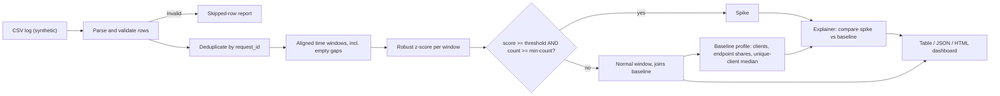

# SpikeSentry

> **Explainable, offline spike detection for API request traffic.**
> SpikeSentry reads request logs, removes duplicates, groups requests into time windows, flags unusual bursts with a robust statistical detector and says *why* each burst looks suspicious. It never touches a live API.

| | |
|---|---|
| **Hackathon** | AEGYTHON 2026 · Challenge 03 · *API Traffic Watch* (beginner-friendly) |
| **Team ID** | `<TEAM-ID>` |
| **Source / review tag** | `<REPO-URL>` · tag `v1.0-review` |
| **Demo video (2 min or less)** | `<VIDEO-URL>` |
| **Language / dependencies** | Python 3.9+ · standard library only · no network |
| **License** | MIT |

---

## Table of contents
1. [Why SpikeSentry](#1-why-spikesentry)
2. [Features at a glance](#2-features-at-a-glance)
3. [Quick start](#3-quick-start)
4. [Command-line reference](#4-command-line-reference)
5. [Input format](#5-input-format)
6. [Output formats](#6-output-formats)
7. [How it works](#7-how-it-works)
8. [The intelligent technique in depth](#8-the-intelligent-technique-in-depth)
9. [Validation and results](#9-validation-and-results)
10. [Test suite](#10-test-suite)
11. [Design decisions](#11-design-decisions)
12. [Safety, privacy and scope](#12-safety-privacy-and-scope)
13. [Known limitations](#13-known-limitations)
14. [Roadmap](#14-roadmap)
15. [Project structure](#15-project-structure)
16. [Reproducibility checklist](#16-reproducibility-checklist)
17. [Data, model attribution and licensing](#17-data-model-attribution-and-licensing)
18. [Submission mapping](#18-submission-mapping)
19. [FAQ](#19-faq)

---

## 1. Why SpikeSentry

A sudden burst of API requests can mean a credential-stuffing attack on `/login`, a scraper crawling a catalogue, a misbehaving client stuck in a retry loop, or an early DDoS. Simple tools fail in two ways:

- **They raise flags without context.** "Window 12:09 had 68 requests" doesn't tell an on-call engineer what to do next.
- **They use statistics that bursts can fool.** The textbook mean/standard-deviation z-score is pulled up by the very spike it should detect. A big spike inflates the standard deviation and partly hides itself, and when several spikes occur together they hide one another. This is called *masking*.

SpikeSentry addresses both problems. It uses a **median/MAD robust score** that spikes cannot inflate, and it adds a **baseline-comparison explainer** that turns each flag into human-readable evidence: *who* sent the traffic, *what* it targeted and *whether those clients have ever been seen before*.

The challenge architecture maps directly onto the tool:

```
API Requests  ->  Traffic Monitor  ->  Spike Detection  ->  Dashboard
 (CSV log)        (parse, dedup,        (robust z-score     (terminal table,
                   time windows)         + explanation)      HTML report, JSON)
```

---

## 2. Features at a glance

| Capability | Details |
|---|---|
| **Offline entrypoint** | One file, `spikesentry.py`. No installs, no network, no live API. |
| **Validation on load** | Bad timestamps, NaN or negative epochs and missing IDs are skipped and reported with their **line number**. Bad headers and missing files fail cleanly with exit code `2`. |
| **Deduplication** | Repeated `request_id`s (retries, replays, double-logging) are counted once, and the number dropped is reported. |
| **Aligned time windows** | Windows start on round boundaries (e.g. `12:09:00`). **Empty windows are kept**, so quiet periods count toward the baseline. |
| **Robust spike detection** | Median/MAD z-score with a minimum-volume guard. Flat traffic never causes division by zero. |
| **Explanations** | Each spike gets a severity, a pattern type and evidence: single-source share, endpoint focus vs. baseline, new clients, distributed fan-out. |
| **Three output formats** | Readable terminal table, machine-readable JSON, and a self-contained offline HTML dashboard. |
| **Measured accuracy** | `evaluate.py` scores the detector on 500 labeled synthetic series and compares it with the mean/stddev z-score. |
| **Test coverage** | 17 unit tests across normal, edge and invalid input, including the CLI paths. |

---

## 3. Quick start

```bash
git clone <REPO-URL> spikesentry
cd spikesentry
python --version                      # 3.9 or newer

python spikesentry.py data/sample.csv                       # table + explanations
python spikesentry.py data/sample.csv --html report.html    # offline dashboard
python spikesentry.py data/sample.csv --json                # JSON for other tools
python -m unittest discover -s tests -t . -v                # run the 17 tests
python evaluate.py                                          # accuracy validation
```

On Windows, use `python` or `py`, and either `/` or `\` in paths. No virtual environment is needed because there are no third-party packages.

To regenerate the sample dataset (seeded, so the output is identical every time):
```bash
python data/make_sample.py
```

### What you should see
```
Rows read: 218  duplicates dropped: 1  invalid: 2

WINDOW START (UTC)      REQS  CLIENTS  TOP ENDPOINT        SCORE  FLAG
2026-11-01T12:00:00Z      10        5  /profile            -0.67        ###
2026-11-01T12:01:00Z      12        5  /profile             0.67        ####
...
2026-11-01T12:08:00Z      10        5  /profile            -0.67        ###
2026-11-01T12:09:00Z      68        7  /login              38.45  SPIKE ####################
2026-11-01T12:10:00Z      11        4  /items                0.0        ###
...
2026-11-01T12:14:00Z       8        4  /profile            -2.02        ##

Spikes flagged: 1
  2026-11-01T12:09:00Z [high] single-source burst (possible brute force / scraping)
    - single source: bot-1 sent 56/68 requests (82%)
    - endpoint focus: /login is 100% of window vs 0% in baseline
    - new clients: 1 not seen in normal windows (bot-1)
  skipped line 218: Invalid isoformat string: 'not-a-date'
  skipped line 219: missing request_id
```
The full outputs are saved in [`evidence/`](evidence/).

---

## 4. Command-line reference

```
python spikesentry.py INPUT [--window SECONDS] [--threshold Z] [--min-count N] [--json] [--html PATH]
```

| Argument | Default | Meaning |
|---|---|---|
| `INPUT` | required | Path to a CSV file, or `-` to read from stdin. |
| `--window` | `60` | Window length in seconds. Must be > 0. |
| `--threshold` | `3.5` | Robust z-score needed to flag a window. Lower values flag more. |
| `--min-count` | `10` | Minimum requests a window must contain to be flagged. This stops tiny windows from being flagged on noise. |
| `--json` | off | Print JSON instead of the table. |
| `--html PATH` | off | Also write an HTML dashboard to `PATH`. |

**Exit codes:** `0` means success (even if some rows were skipped). `2` means the file could not be read, the header was invalid, an option was invalid or the input could not be decoded. Error messages start with `error:` and go to stderr.

**Tuning tips**
- Bursty, low-volume APIs: raise `--min-count` to cut noise.
- Short attacks being diluted: lower `--window` (e.g. `10`).
- Too many or too few alerts: adjust `--threshold`. 3.5 is the value commonly recommended for MAD-based outlier detection (Iglewicz and Hoaglin).

---

## 5. Input format

The input is a UTF-8 CSV file (a BOM is tolerated) with a header row containing **at least** these columns, in any order:

| Column | Type | Rules |
|---|---|---|
| `timestamp` | ISO-8601 or epoch seconds | `2026-11-01T12:00:05Z`, `2026-11-01T12:00:05+05:30` or `1793534405`. Times without a timezone are treated as **UTC**. Negative, NaN and infinite values are rejected. |
| `request_id` | string | Required and non-empty. Used for deduplication. |
| `client` | string | Client identifier (synthetic API key, IP alias, etc.). Blank values become `?`. |
| `endpoint` | string | Request path. Blank values become `?`. |

Extra columns are ignored. Example:
```csv
timestamp,request_id,client,endpoint
2026-11-01T12:00:05Z,r1,client-3,/items
2026-11-01T12:00:09Z,r2,client-1,/search
2026-11-01T12:09:14Z,r57,bot-1,/login
```

**What counts as an invalid row** (skipped, reported, run continues): an unparseable or empty timestamp, a negative, NaN or infinite epoch, or an empty `request_id`.
**What counts as a fatal error** (exit 2): a missing or unreadable file, a header missing a required column, an invalid option or undecodable bytes.

---

## 6. Output formats

### 6.1 Terminal table
One row per window with its start time (UTC), request count after deduplication, unique clients, most-requested endpoint, robust score, `SPIKE` flag and a bar scaled to the busiest window. Below the table come the spike explanations, any warnings and the skipped rows.

### 6.2 JSON (`--json`)
```json
{
  "total_rows": 218,
  "duplicates": 1,
  "invalid": [[218, "Invalid isoformat string: 'not-a-date'"], [219, "missing request_id"]],
  "warnings": [],
  "windows": [
    {"start": "2026-11-01T12:08:00Z", "count": 10, "unique_clients": 5,
     "top_endpoint": "/profile", "score": -0.67, "spike": false},
    {"start": "2026-11-01T12:09:00Z", "count": 68, "unique_clients": 7,
     "top_endpoint": "/login", "score": 38.45, "spike": true,
     "severity": "high",
     "kind": "single-source burst (possible brute force / scraping)",
     "reasons": ["single source: bot-1 sent 56/68 requests (82%)",
                 "endpoint focus: /login is 100% of window vs 0% in baseline",
                 "new clients: 1 not seen in normal windows (bot-1)"]}
  ]
}
```
`severity`, `kind` and `reasons` appear only on spike windows.

### 6.3 HTML dashboard (`--html report.html`)
A single self-contained file with no external scripts, fonts or network calls. It contains:
- summary cards (rows, windows, duplicates, invalid rows, spikes)
- a bar chart of requests per window, with spikes in red; hover a bar for its exact count and score
- explanation cards for each spike
- the full window table, with spike rows highlighted
- warnings and skipped rows

All user-supplied text is HTML-escaped, so a malicious `endpoint` value cannot inject script. A sample is at [`evidence/sample_report.html`](evidence/sample_report.html).

---

## 7. How it works



**Stage by stage**

1. **Parse and validate** (`read_rows`). A streaming `csv.DictReader` reads the file. It checks the header, parses timestamps (ISO-8601 or epoch) and requires a `request_id`. A bad row produces a `(line_number, reason)` entry instead of an exception.
2. **Deduplicate.** A set of seen IDs keeps the first occurrence of each `request_id`.
3. **Window.** `t0 = floor(min_ts / window) * window` aligns windows to round boundaries. Every window from `t0` to the last event is created, **including empty ones**.
4. **Score** (`robust_scores`, `flag_counts`). See [§8](#8-the-intelligent-technique-in-depth).
5. **Build the baseline.** All requests in *non-flagged* windows form the baseline: the set of known clients, each endpoint's normal share, and the median number of unique clients per window.
6. **Explain** (`explain`). Each spike window is compared with that baseline.
7. **Render** (`render`, `render_html`, JSON).

The algorithm runs in `O(n + w log w)` time and uses `O(n + w)` memory, for `n` requests and `w` windows.

---

## 8. The intelligent technique in depth

### 8.1 Robust z-score (median / MAD)

For window counts $c_1, \dots, c_w$:

$$
\tilde{c} = \operatorname{median}(c_i), \qquad
\mathrm{MAD} = \operatorname{median}\big(|c_i - \tilde{c}|\big), \qquad
s_i = \frac{c_i - \tilde{c}}{\max(1.4826 \cdot \mathrm{MAD},\ 1)}
$$

A window is a **spike** when $s_i \ge \text{threshold}$ (default 3.5) **and** $c_i \ge \text{min-count}$ (default 10).

- **1.4826** rescales the MAD so that it estimates the standard deviation for normally distributed data. Scores therefore read like ordinary z-scores.
- **The floor of 1** handles perfectly flat traffic (MAD = 0) without dividing by zero. It also means a deviation of less than one request never counts as large.
- The median and the MAD have a **50% breakdown point**: up to half the windows can be extreme without corrupting the baseline. The mean and standard deviation have a breakdown point of 0%, so one extreme value can shift them arbitrarily.

### 8.2 Worked example on `data/sample.csv`

The 15 one-minute windows contain these counts:
`10, 12, 12, 10, 9, 11, 12, 10, 10, 68, 11, 11, 9, 12, 8`

| Step | Robust (SpikeSentry) | Classic mean/stddev |
|---|---|---|
| Centre | median = **11** | mean = **14.33** (pulled up by the spike) |
| Spread | MAD = 1, so scale = **1.48** | stddev = **14.39** (inflated by the spike) |
| Score of the 68-request window | (68 − 11) / 1.48 = **38.45** | (68 − 14.33) / 14.39 = **3.73** |

The spike is about **6× the normal rate**, yet the classic z-score only just clears 3. In fact it **cannot** go higher: by Samuelson's inequality, a population z-score in a sample of *n* values is bounded by $\sqrt{n-1}$, which is $\sqrt{14} \approx 3.74$ here. However extreme the burst, the classic method can never score it above 3.74 with 15 windows, and two or three simultaneous spikes push the bound lower still. The robust score has no such limit. This is the masking effect measured in [§9](#9-validation-and-results).

### 8.3 Explaining a spike against the baseline

The baseline is all requests in non-spike windows. For each spike window, SpikeSentry checks:

| Signal | Rule | What it suggests |
|---|---|---|
| **Single source** | Top client sent ≥ 50% of the window's requests | One actor driving the burst: brute force, a scraper, a stuck retry loop |
| **Endpoint focus** | Top endpoint ≥ 50% of the window **and** ≥ 30 percentage points above its baseline share | Targeted activity (e.g. `/login` going from 0% to 100%) |
| **New clients** | Clients in the window never appear in normal windows | Unknown actors; lists up to 3 |
| **Distributed** | Unique clients ≥ 3× the baseline median per window | Many sources at once (DDoS-like, or a botnet) |

**Pattern type.** If the single-source signal fires, the pattern is *single-source burst*. Otherwise, if the distributed signal fires, it is *distributed burst*. Otherwise it is *volume surge*, with the note "request volume rose with a normal client/endpoint mix" when no signal fires. A volume surge often means legitimate load, such as a marketing campaign or a batch job.

**Severity.** `high` if $s_i \ge 2 \times \text{threshold}$, otherwise `medium`.

All explanation thresholds are deliberately simple and visible, so each reason can be checked by hand against the table. These are recommendations for a human analyst. **SpikeSentry never blocks or enforces anything.**

### 8.4 Is this AI/ML?
SpikeSentry is a **transparent statistical anomaly detector with rule-based explanation**. This family of techniques is widely used in production monitoring because it needs no training data, adapts automatically to each input's own baseline, and makes every decision traceable. No model is trained and no learned weights are used.

---

## 9. Validation and results

### 9.1 Method (`evaluate.py`)
- **500 synthetic series × 30 windows.** Each series has a random base rate λ ∈ [10, 60] requests per window, with Poisson-distributed counts (exact Poisson sampling for λ < 30, normal approximation above).
- Each series gets **0 to 3 injected spikes** at random windows. Each spike's size is drawn from **2×, 3×, 4× or 6×** λ.
- The injected windows are the ground-truth labels. Both detectors run on the same counts:
  - **robust**: SpikeSentry's `flag_counts` (threshold 3.5, min-count 10)
  - **meanstd**: classic z-score (threshold 3.0, min-count 10)
- A fixed seed (42) makes every run identical. Saved output: [`evidence/evaluation.txt`](evidence/evaluation.txt).

### 9.2 Results

| Method | TP | FP | FN | Precision | Recall | F1 | False positives per 1,000 normal windows |
|---|---|---|---|---|---|---|---|
| **SpikeSentry (robust)** | 767 | 23 | 37 | 0.971 | **0.954** | **0.962** | 1.62 |
| mean/stddev z ≥ 3 | 440 | 5 | 364 | 0.989 | 0.547 | 0.705 | 0.35 |

| Spike size | n | Robust recall | Mean/stddev recall |
|---|---|---|---|
| 2× | 190 | **0.83** | 0.19 |
| 3× | 209 | **0.98** | 0.38 |
| 4× | 201 | **1.00** | 0.63 |
| 6× | 204 | **1.00** | 0.96 |

### 9.3 Interpretation
- SpikeSentry finds **327 more real spikes** (767 vs 440) and raises F1 from 0.71 to 0.96.
- The gap is widest on **small spikes (2× to 3×)** and on series with **several spikes**, where masking hurts the classic method most.
- The trade-off is about 1.6 false alarms per 1,000 normal windows. At one-minute windows that is roughly 2 to 3 alerts per day on purely random traffic, a reasonable cost for catching 4 out of 5 small attacks. Raise `--threshold` to trade recall for fewer alerts.
- Remaining misses are mostly 2× spikes on low-volume series, where a doubling is still close to Poisson noise.

---

## 10. Test suite

Run with `python -m unittest discover -s tests -t . -v`. There are 17 tests, which finish in about 0.05 s. Saved run: [`evidence/test_run.txt`](evidence/test_run.txt).

| Category | Test | Verifies |
|---|---|---|
| Normal | `test_steady_traffic_no_spike` | Stable traffic gives no false alarms |
| Normal | `test_spike_flagged_once` | Exactly one window flagged, the right one |
| Normal | `test_spike_explained_single_source` | Pattern type, culprit client, endpoint, new-client reason, `high` severity |
| Normal | `test_iso_timestamps` | ISO `Z` and `+00:00` parse correctly; windows align to `:00` |
| Normal | `test_html_dashboard` | The HTML contains a chart and explanations |
| Edge | `test_duplicates_dropped` | Repeated IDs are counted once and reported |
| Edge | `test_header_only` | Empty data gives no windows and a clear warning |
| Edge | `test_empty_gap_windows_included` | Gaps appear as zero-count windows |
| Edge | `test_flat_traffic_no_divide_by_zero` | MAD = 0 is handled; all scores are 0 |
| Edge | `test_small_spike_below_min_count_ignored` | The min-count guard works |
| Edge | `test_few_windows_warning` | An unreliable-baseline warning when there are fewer than 5 windows |
| Edge | `test_html_escapes_input` | `<script>` in input is escaped (XSS-safe) |
| Invalid | `test_invalid_rows_skipped` | Bad, negative and NaN timestamps and missing IDs are skipped with line numbers |
| Invalid | `test_bad_header` | A missing required column raises a clear error |
| Invalid | `test_bad_window` | `--window 0` is rejected |
| Invalid | `test_cli_missing_file` | A missing file gives exit code 2 |
| Invalid / CLI | `test_cli_json_and_html` | End-to-end CLI run producing valid JSON and an HTML file |

---

## 11. Design decisions

| Decision | Why |
|---|---|
| **Median/MAD instead of mean/stddev** | Spikes cannot inflate their own baseline (see §8.2 and §9). |
| **Keep empty windows** | Without them, a quiet API with one burst would have a baseline made only of busy windows, hiding the burst. Gaps are real data. |
| **Aligned windows** | `12:09:00`-style boundaries are easier to read and to match with other logs than boundaries offset by the first event's seconds. |
| **`min-count` guard** | On very quiet traffic, going from 0 to 3 requests can produce a huge robust score. A minimum volume keeps alerts meaningful. |
| **Baseline = non-spike windows** | Explanations compare a spike with *normal* traffic, not with an average that includes other spikes. |
| **Skip bad rows instead of aborting** | Real logs are messy. One malformed line shouldn't hide an attack, and reporting line numbers keeps the skip auditable. |
| **Standard library only** | Zero-friction reproduction for reviewers, nothing to break, no supply-chain risk. |
| **Self-contained HTML** | Works offline and on air-gapped machines, with no CDN and nothing to leak. |
| **Explanations as plain sentences** | Readers don't need to know statistics, and each reason can be checked against the table. |

---

## 12. Safety, privacy and scope
- **Offline only.** No sockets, no HTTP clients and no live-API interaction. It satisfies the challenge rule: *"without affecting a real API."*
- **Synthetic data only.** The bundled data is generated by a seeded script. No real traffic, IP addresses, users or credentials.
- **Recommendations, not enforcement.** SpikeSentry flags and explains. It never blocks, rate-limits or bans.
- **Output hardening.** All user-controlled strings are HTML-escaped in the dashboard.
- **Bounded resources.** Inputs that would create more than 1,000,000 windows (e.g. a tiny `--window` over a huge time range) are rejected with a clear error instead of exhausting memory.

---

## 13. Known limitations
1. **Fixed (tumbling) windows.** A burst that straddles a boundary is split in two, and each half scores lower. Mitigation: a smaller `--window`. A sliding-window mode is on the roadmap.
2. **Single global baseline.** There is no handling of seasonality (day/night), trends or per-endpoint baselines, so a spike on a low-traffic endpoint can be hidden inside high total traffic.
3. **Baseline needs data.** Fewer than about 5 windows makes the median unreliable (the tool warns). If more than half the windows are spikes, the median itself shifts.
4. **Deduplication is ID-based only.** Identical requests with different `request_id`s are counted separately.
5. **Batch, in-memory processing.** The whole file is loaded. It is not a streaming or real-time monitor.
6. **Heuristic explanation thresholds.** The 50%, 30 pp and 3× cut-offs are hand-picked and validated only on synthetic data.
7. **Synthetic evaluation.** Results reflect Poisson-like traffic with injected multiplicative spikes. Real traffic is burstier and has heavier tails, so expect more false positives there.
8. **No drops or outages.** Only *upward* spikes are flagged. Sudden drops in traffic, which can signal an outage, are scored but not flagged.

---

## 14. Roadmap
- **Per-endpoint and per-client baselines** to surface targeted spikes hidden in total volume.
- **Sliding windows** (or two offset tumbling grids) to fix burst splitting.
- **Drop detection** (score ≤ −threshold) for outage hints.
- **Seasonal baselines** (same hour on previous days) for long logs.
- **Streaming / replay mode** with a rolling median for near-real-time use.
- **Configurable explanation rules** via a small JSON file.

---

## 15. Project structure
```
spikesentry/
├── spikesentry.py            # CLI entrypoint: parse → dedup → window → score → explain → render
├── evaluate.py               # Labeled synthetic validation (robust vs mean/stddev)
├── data/
│   ├── make_sample.py        # Seeded synthetic data generator
│   └── sample.csv            # 218 rows: 15 min of traffic, 1 brute-force burst, 1 duplicate, 2 invalid rows
├── tests/
│   ├── __init__.py
│   └── test_spikesentry.py   # 17 unit tests (normal / edge / invalid / CLI)
├── evidence/
│   ├── environment.txt       # Python version and OS used for the saved runs
│   ├── test_run.txt          # Saved unit-test output
│   ├── evaluation.txt        # Saved validation output
│   ├── sample_output.txt     # Saved terminal output for sample.csv
│   ├── sample_output.json    # Saved JSON output for sample.csv
│   └── sample_report.html    # Saved HTML dashboard for sample.csv
├── DEMO_SCRIPT.md            # Plan for the 2-minute demo video
├── LICENSE                   # MIT
└── README.md
```

**Code map** (`spikesentry.py`)

| Function | Role |
|---|---|
| `parse_ts` | ISO-8601 / epoch parsing and validation |
| `read_rows` | Header check and per-row validation with line numbers |
| `robust_scores`, `flag_counts` | Median/MAD scoring and the flag decision |
| `explain` | Baseline comparison giving pattern type and reasons |
| `analyze` | Full pipeline; returns a `Result` |
| `render`, `render_html` | Terminal and HTML output |
| `main` | CLI arguments, I/O, exit codes |

---

## 16. Reproducibility checklist
- [x] One command runs the tool: `python spikesentry.py data/sample.csv`
- [x] No dependencies beyond Python 3.9+
- [x] Seeded data generator and seeded evaluation, so outputs are identical across runs
- [x] Saved outputs in `evidence/` to compare against
- [x] Frozen review tag `v1.0-review`
- [x] Tested on Windows with Python 3.12.10. Only standard-library, cross-platform code is used.

---

## 17. Data, model attribution and licensing
- **Data:** 100% synthetic, produced by `data/make_sample.py` (seed 7) and `evaluate.py` (seed 42). No third-party, real or personal data.
- **Models:** none. No pretrained or learned models are used.
- **Libraries:** the Python standard library only.
- **Methods:** the median absolute deviation and its 1.4826 consistency constant are standard robust-statistics tools. The 3.5 modified-z threshold follows Iglewicz and Hoaglin, *How to Detect and Handle Outliers* (1993). The z-score bound is Samuelson's inequality (1968).
- **License:** MIT. See [`LICENSE`](LICENSE).

---

## 18. Submission mapping

| AEGYTHON requirement | Where |
|---|---|
| Working MVP / executable prototype | `spikesentry.py` |
| Window summarizer with deduplicated requests, spike flags and readable output | §3, §6 |
| Offline entrypoint | `python spikesentry.py data/sample.csv` |
| Setup / input / output documentation | §3 to §6 |
| Normal / edge / invalid-input tests | §10, `tests/` |
| Explanation of the AI/ML or intelligent technique | §8 |
| Test or validation evidence | §9, §10, `evidence/` |
| Data/model attribution and licensing | §17, `LICENSE` |
| Known limitations | §13 |
| Public source and frozen tag | `<REPO-URL>`, tag `v1.0-review` |
| Demo video (2 min or less) | `<VIDEO-URL>`; plan in `DEMO_SCRIPT.md` |

---

## 19. FAQ

**Does it connect to or protect a real API?**
No. It analyses CSV logs offline, by design.

**Can I use my own logs?**
Yes, if they are sanitized and have the four required columns. Export or rename your fields to match `timestamp,request_id,client,endpoint`.

**Why was my obvious spike not flagged?**
Check three things. Is its count ≥ `--min-count`? Are there at least about 5 windows? Was the burst split across a window boundary? Try a smaller `--window` or a lower `--threshold`.

**Why are there windows with zero requests?**
Gaps in the log are real periods of no traffic. Keeping them makes the baseline honest.

**Why 3.5 and not 3?**
Robust z-scores come from a tighter spread estimate than classic ones, so 3.5 is the standard cut-off for MAD-based scores. It is configurable.
